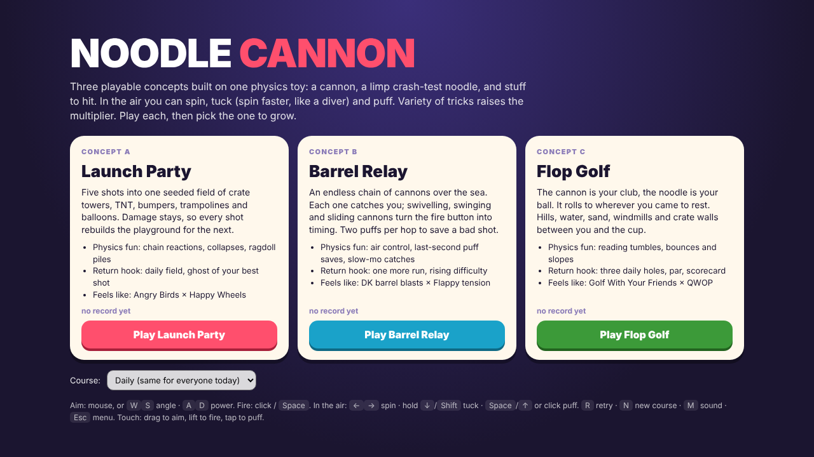
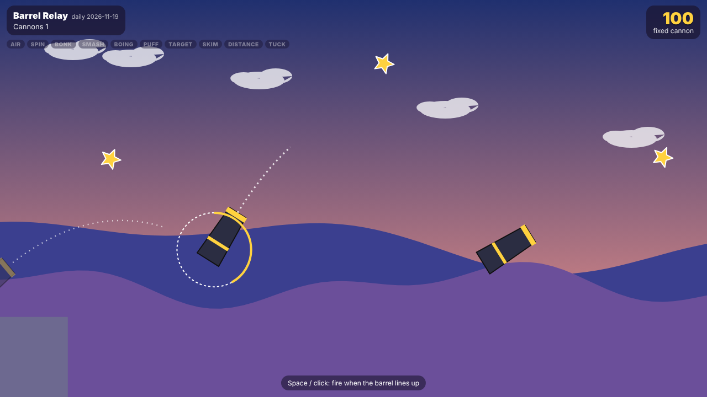
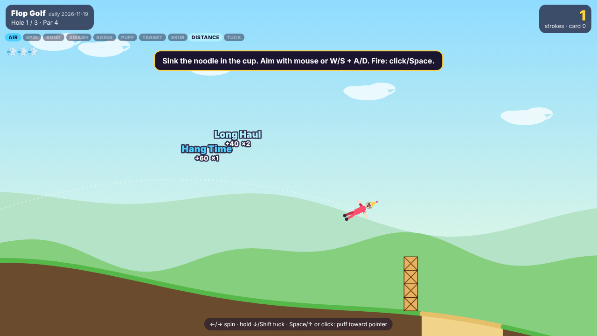

# Noodle Cannon

A cannon, a limp crash-test noodle, and things to hit. A standalone game that grew out of what worked best in [x3d.gamelab](https://github.com/hagopjay/x3d.gamelab), which was the cannon and the ragdoll chaos that follows a shot.

This first version is a **concept sampler**: three playable game ideas share one physics engine, so you can play them all and choose which one to build out. See [CONCEPTS.md](CONCEPTS.md) for the choices and [LESSONS.md](LESSONS.md) for what was carried over from the gamelab.



| Concept | Loop | Screenshot |
|---|---|---|
| **A · Launch Party** | 5 shots into a seeded field of crate towers, TNT, bumpers, trampolines and balloons. The damage stays between shots. |  |
| **B · Barrel Relay** | An endless chain of cannons over the sea. Each cannon catches you, and the swivelling and swinging ones make firing a timing test. |  |
| **C · Flop Golf** | The cannon is the club and the noodle is the ball. Each shot fires from wherever the noodle stopped. |  |

## Play

Open `dist/noodle-cannon.html` in any modern browser. It is a single self-contained file: no server, no install and no network.

During development, serve the folder (`python3 -m http.server`) and open `index.html`, which loads `src/` as ES modules.

| Action | Keys | Mouse / touch |
|---|---|---|
| Aim | W/S angle, A/D power | the barrel follows the pointer; distance sets power / drag |
| Fire | Space | click / lift your finger |
| Spin in the air | ← / → | ⟲ ⟳ buttons |
| Tuck (spin faster, fall cleaner) | hold ↓ or Shift | hold the pointer / TUCK |
| Puff (3 per shot; 2 per hop in Relay) | Space / ↑, plus arrow keys for direction | click or tap: puffs toward the pointer |
| Retry / new course / sound / menu | R / N / M / Esc | buttons on the results screen |

## Layout

```
src/engine.js      deterministic 2D position-based physics: particles, sticks, crates (convex quads), static shapes, sleeping
src/noodle.js      the ragdoll (11 particles, joint limits, tuck muscles), the cannon, and the trick judge
src/modes/*.js     base (aim / fly / puff / TNT), launch, relay, golf. No DOM.
src/render.js      Canvas2D view: parallax, crates, noodle face, trails, particles, popups
src/audio.js       synthesised sound effects (no audio files)
src/main.js        input, fixed 60 Hz loop, hit-stop, slow motion, HUD, menus, local records and ghost
build.mjs          inlines the modules into dist/noodle-cannon.html (no dependencies)
test/sim.test.mjs  physics and gameplay gates (node --test)
tools/browser-check.mjs  headless Chrome: plays each concept, takes screenshots, counts console errors
```

## Verify

```sh
npm test               # 9 gates: stack rest, wake-on-hit, tuck spin-up, determinism x3 concepts, a round of each concept completes
npm run build          # dist/noodle-cannon.html
npm run check:browser  # needs playwright-core and Chrome (set PLAYWRIGHT_CORE / CHROME if they are not on the default path)
```

**What was checked (19 Nov 2026, Node 22.23.5, headless Chrome on SwiftShader, one cloud machine):** all 9 gates pass. The browser script loaded the built file with 0 console errors, fired a shot in each concept, ran at a 60 fps frame rate, and loaded the menu and the game on a 390 px phone viewport. Launch Party averages about 1.9 ms per simulation tick (Node, 97 crates, five noodles). **Not checked:** a real GPU, real phones, Firefox or Safari, gamepads, and a human playing for fun. Nobody has playtested this yet; that is the next step.
