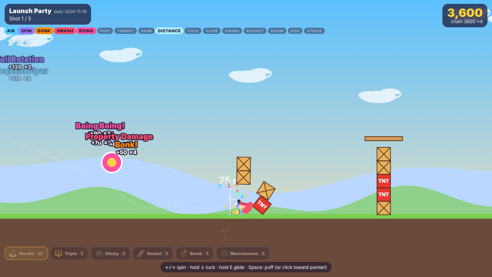
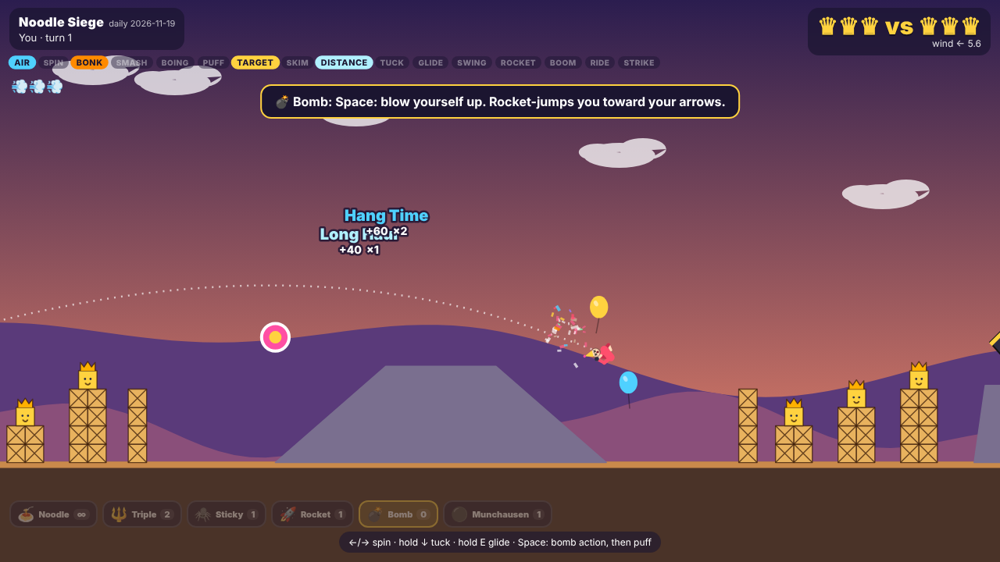
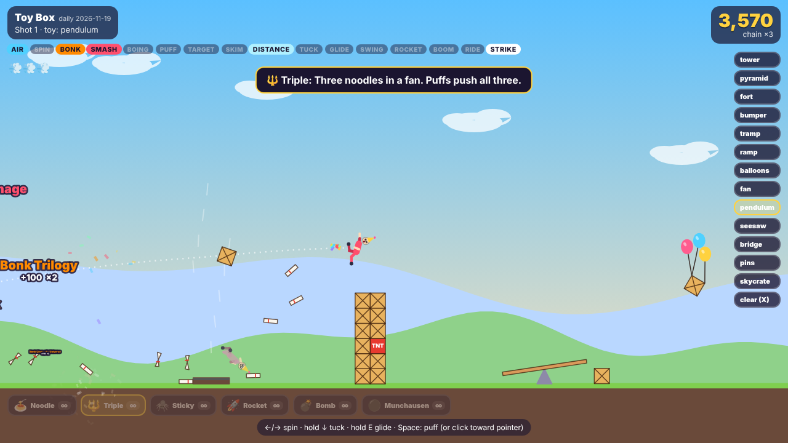

# Noodle Cannon

A cannon, a limp crash-test noodle, and things to hit. A standalone game that grew out of what worked best in [x3d.gamelab](https://github.com/hagopjay/x3d.gamelab), which was the cannon and the ragdoll chaos that follows a shot.

This is a **concept sampler**: five playable game ideas share one physics engine, six kinds of ammo and a box of toys, so you can play them all and choose which one to build out. (v0.1 had three concepts; v0.2 added the ammo, gliding, the toys, Noodle Siege and the Toy Box.) See [CONCEPTS.md](CONCEPTS.md) for the choices and [LESSONS.md](LESSONS.md) for what was carried over from the gamelab.


| Concept | Loop | Screenshot |
|---|---|---|
| **A · Launch Party** | 5 shots into a seeded field of crate towers, TNT, bumpers, trampolines and balloons. The damage stays between shots. |  |
| **B · Barrel Relay** | An endless chain of cannons over the sea. Each cannon catches you, and the swivelling and swinging ones make firing a timing test. |  |
| **C · Flop Golf** | The cannon is the club and the noodle is the ball. Each shot fires from wherever the noodle stopped. |  |
| **D · Noodle Siege** *(v0.2)* | Two forts with three crowned kings each, and wind that changes every turn. Play against the CPU (which forecasts its arcs) or a friend on the same screen. |  |
| **E · Toy Box** *(v0.2)* | Sandbox with unlimited shots and every ammo; you drop the toys yourself. |  |

## Firepower (v0.2)

| Key | Ammo | Space in the air |
|---|---|---|
| 1 | 🍝 Noodle | puff (×3) |
| 2 | 🔱 Triple: three noodles in a fan | puff pushes all three |
| 3 | 🕷️ Sticky: hands grab the first thing they touch (ground, crate, another body) | let go, with a whip (two grabs per shot) |
| 4 | 🚀 Rocket boots: thrust on the feet, off-centre, so they tumble you | hold for 1.6 s of fuel |
| 5 | 💣 Bomb | blow yourself up: a rocket jump toward your arrows that throws everything nearby |
| 6 | ⚫ Munchausen: ride a 30 kg cannonball | let go; the ball keeps smashing |

Launch Party gives one of each special per round; Siege gives a small supply per player; Toy Box gives unlimited ammo.

**Ragdoll moves:** spin (←/→), tuck (↓, spins about 3.6× faster), spread to glide (hold E, a flat-plate air model, so belly-first falls brake and shallow dives fly), plus idle arm-flailing.

**Toys:** crate towers, pyramids, TNT forts, bumpers, trampolines, ramps, balloons, fans (an updraft that lifts a limp noodle while a tucked one punches through), a pendulum wrecking ball, a seesaw catapult, a rope bridge of planks with TNT in the middle, ten bowling pins (STRIKE!) and sky crates held up by balloons.

## Play

Open `dist/noodle-cannon.html` in any modern browser. It is a single self-contained file: no server, no install and no network.

During development, serve the folder (`python3 -m http.server`) and open `index.html`, which loads `src/` as ES modules.

| Action | Keys | Mouse / touch |
|---|---|---|
| Aim | W/S angle, A/D power | the barrel follows the pointer; distance sets power / drag |
| Fire | Space | click / lift your finger |
| Spin in the air | ← / → | ⟲ ⟳ buttons |
| Pick ammo | 1–6, or Q to cycle | ammo bar |
| Tuck (spin faster, fall cleaner) | hold ↓ or Shift | hold the pointer / TUCK |
| Spread and glide | hold E | GLIDE |
| Slow motion | Z | |
| Toy Box: drop a toy / pick a toy / clear | right-click or T / toy bar or [ ] / X | toy bar |
| Puff (3 per shot; 2 per hop in Relay) | Space / ↑, plus arrow keys for direction | click or tap: puffs toward the pointer |
| Retry / new course / sound / menu | R / N / M / Esc | buttons on the results screen |

## Layout

```
src/engine.js      deterministic 2D position-based physics: particles, sticks, crates (convex quads), static shapes, sleeping
src/noodle.js      the ragdoll (11 particles, joint limits, tuck/spread muscles, aero), the cannon, and the trick judge (16 families)
src/toys.js        the toy box: 14 builders shared by every mode
src/modes/*.js     base (aim / ammo / fly / puff / TNT / blasts), launch, relay, golf, siege, toybox. No DOM.
src/render.js      Canvas2D view: parallax, crates, noodle face, trails, particles, popups
src/audio.js       synthesised sound effects (no audio files)
src/main.js        input, fixed 60 Hz loop, hit-stop, slow motion, HUD, menus, local records and ghost
build.mjs          inlines the modules into dist/noodle-cannon.html (no dependencies)
test/sim.test.mjs  physics and gameplay gates (node --test)
tools/browser-check.mjs  headless Chrome: plays each concept, takes screenshots, counts console errors
```

## Verify

```sh
npm test               # 17 gates: stack rest, wake-on-hit, tuck spin-up, glide, toys settle, every ammo, bomb/rocket speed, sticky grab,
                       # determinism, and a full round of every concept (Siege: CPU vs CPU on 6 seeds)
npm run build          # dist/noodle-cannon.html
npm run check:browser  # needs playwright-core and Chrome (set PLAYWRIGHT_CORE / CHROME if they are not on the default path)
```

**What was checked (v0.2, 19 Nov 2026, Node 22.23.5, headless Chrome on SwiftShader, one cloud machine):** all 17 gates pass. The browser script loaded the built file with 0 console errors. It fired every concept plus rocket, Munchausen and sticky with glide, played a Siege turn against the CPU, and dropped a toy in the Toy Box, at a 60 fps frame rate. Simulation cost is about 1–4 ms per tick in Node (Siege and Launch Party are the heaviest). **Not checked:** a real GPU, real phones, Firefox or Safari, gamepads, and a human playing for fun.